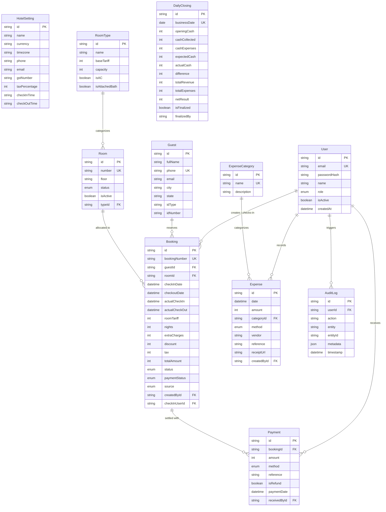

# Database Schema & Data Dictionary — DURGA LODGE HMS

DURGA LODGE HMS uses a normalized **PostgreSQL 15** relational schema managed through **Prisma ORM** with the `@prisma/adapter-pg` driver.

---

## 1. Entity-Relationship Overview



---

## 2. Table Specifications & Data Dictionary

### `HotelSetting`
Stores property-wide configuration and tax rates.
- `id` (Text, PK): Fixed key `"durga-lodge-settings"`.
- `name` (Text): Hotel branding (`DURGA LODGE`).
- `currency` (Text): Currency identifier (`INR`).
- `timezone` (Text): Operational timezone (`Asia/Kolkata`).
- `taxPercentage` (Integer): Tax in basis points (`1200` = 12.00% GST).
- `gstNumber` (Text, Nullable): Government tax identifier (`21AAAAA0000A1Z5`).
- `allowNegativeBalanceCheckout` (Boolean): Policy allowing checkout with unpaid balance.

### `User`
Staff accounts with role permissions.
- `id` (UUID, PK): Unique staff identifier.
- `email` (Text, Unique): Login email address.
- `passwordHash` (Text): Argon2 cryptographic hash. Plaintext passwords are never stored.
- `role` (Enum): `ADMIN`, `MANAGER`, `RECEPTION`, `STAFF`.
- `isActive` (Boolean): Account access state.

### `RoomType`
Configurable room categories and base prices.
- `id` (UUID, PK): Unique type identifier.
- `name` (Text): Category name (e.g., `Standard Non-AC`, `Premium AC`).
- `baseTariff` (Integer): Nightly rate stored in integer paise.
- `capacity` (Integer): Standard guest capacity.
- `isAC` (Boolean): Climate control indicator.
- `isAttachedBath` (Boolean): Private ensuite bath indicator.

### `Room`
Physical hotel room inventory.
- `id` (UUID, PK): Unique room identifier.
- `number` (Text, Unique): Room number (e.g., `101`, `201`).
- `floor` (Text): Floor level (`1`, `2`).
- `status` (Enum): `AVAILABLE`, `OCCUPIED`, `RESERVED`, `CLEANING`, `MAINTENANCE`, `OUT_OF_SERVICE`.
- `typeId` (UUID, FK): References `RoomType(id)`.

### `Guest`
Guest customer relationship records.
- `id` (UUID, PK): Unique guest identifier.
- `fullName` (Text): Full legal name.
- `phone` (Text, Unique): Contact phone number.
- `idType` (Text): Government identity document (`Aadhaar`, `PAN`, `Passport`, `Driving License`).
- `idNumber` (Text): Masked document reference.

### `Booking`
Reservations, stay intervals, and derived totals.
- `id` (UUID, PK): Unique booking identifier.
- `bookingNumber` (Text, Unique): Human-readable reference (`DL-YYYYMMDD-XXXX`).
- `checkInDate` / `checkoutDate` (Timestamp): Reserved stay interval.
- `actualCheckIn` / `actualCheckOut` (Timestamp, Nullable): Physical arrival and departure timestamps.
- `roomTariff` (Integer): Captured nightly tariff in paise.
- `nights` (Integer): Stay duration.
- `extraCharges` (Integer): Room amenities, tea/coffee, extra bedding (paise).
- `discount` (Integer): Promotional discounts (paise).
- `tax` (Integer): GST tax computed in paise.
- `totalAmount` (Integer): Final bill amount in paise.
- `status` (Enum): `RESERVED`, `CHECKED_IN`, `CHECKED_OUT`, `CANCELLED`, `NO_SHOW`.
- `paymentStatus` (Enum): `UNPAID`, `PARTIALLY_PAID`, `PAID`, `REFUNDED`.

### `Payment`
First-class payment transactions.
- `id` (UUID, PK): Unique transaction identifier.
- `bookingId` (UUID, FK): References `Booking(id)`.
- `amount` (Integer): Payment value in paise.
- `method` (Enum): `CASH`, `UPI`, `CARD`, `BANK_TRANSFER`, `OTHER`.
- `reference` (Text, Nullable): UPI transaction ID or card authorization code.
- `receivedById` (UUID, FK): Staff member who collected the money.

### `DailyClosing`
Cashier day-end ledger locks.
- `businessDate` (Date, Unique): Normalized date in `Asia/Kolkata`.
- `openingCash` (Integer): Cash in register at opening (paise).
- `cashCollected` (Integer): Cash collected from guest folios (paise).
- `cashExpenses` (Integer): Cash paid out for hotel expenses (paise).
- `expectedCash` (Integer): Calculated cash drawer balance (paise).
- `actualCash` (Integer): Physical cash counted by cashier (paise).
- `difference` (Integer): Reconciliation discrepancy (`actualCash - expectedCash`).
- `isFinalized` (Boolean): Locks day against edits.

### `AuditLog`
Immutable compliance audit records.
- `id` (UUID, PK): Log entry identifier.
- `userId` (UUID, FK): Staff member who performed the operation.
- `action` (Text): Event code (`CHECK_IN`, `PAYMENT_ADDED`, `ROOM_STATUS_CHANGE`, etc.).
- `entity` (Text): Target model name.
- `entityId` (Text): Modified record UUID.
- `metadata` (JSON): Context payload.
- `timestamp` (Timestamp): UTC creation timestamp.

---

## 3. High-Performance Indexing Strategy

1. **Double-Booking Overlap Index**:
   ```sql
   CREATE INDEX "Booking_roomId_checkInDate_checkoutDate_status_idx"
   ON "Booking"("roomId", "checkInDate", "checkoutDate", "status");
   ```
   Enables sub-millisecond range queries during reservation conflict checking.

2. **Audit Trail Query Index**:
   ```sql
   CREATE INDEX "AuditLog_entity_entityId_idx" ON "AuditLog"("entity", "entityId");
   CREATE INDEX "AuditLog_userId_timestamp_idx" ON "AuditLog"("userId", "timestamp");
   ```

3. **Daily Closing Date Unique Index**:
   ```sql
   CREATE UNIQUE INDEX "DailyClosing_businessDate_key" ON "DailyClosing"("businessDate");
   ```
